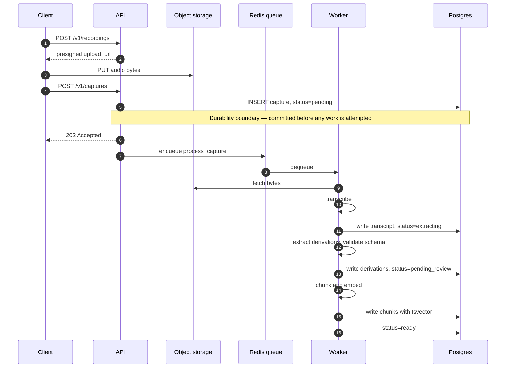
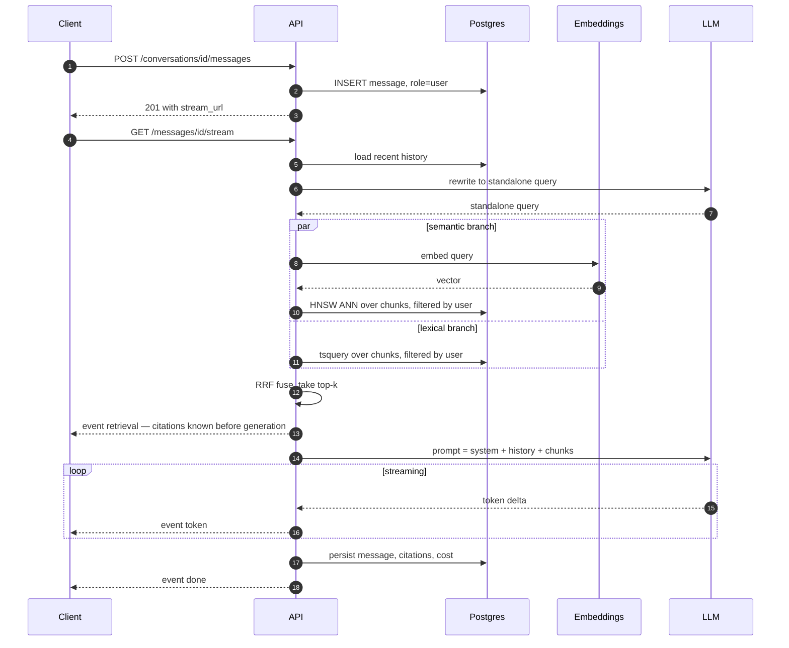
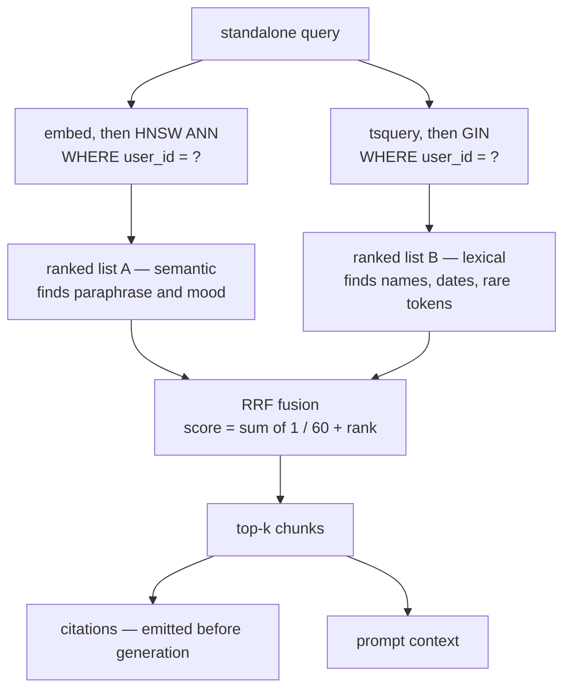
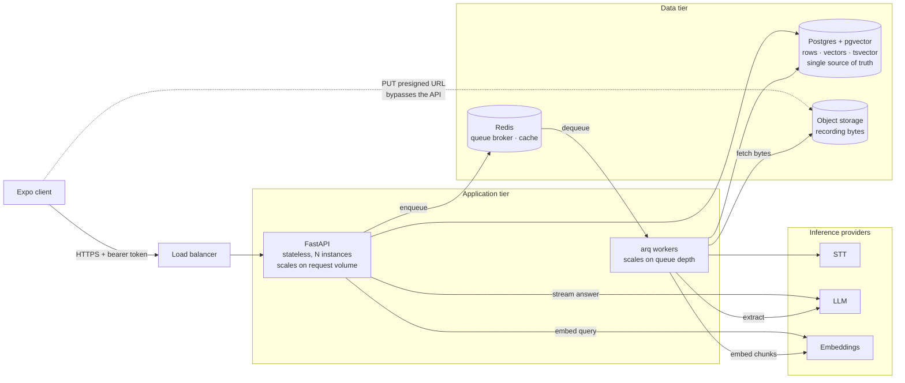
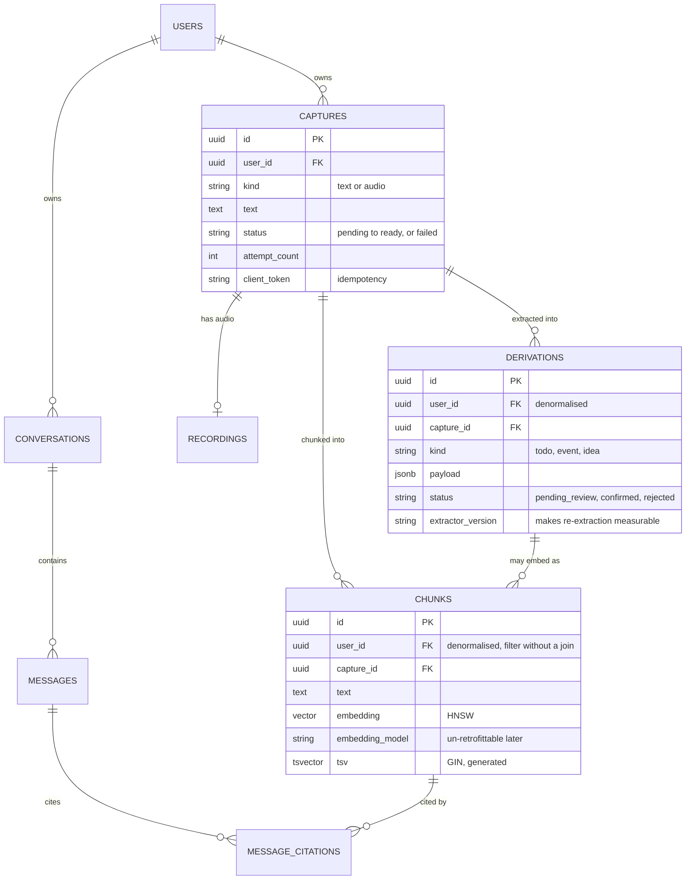
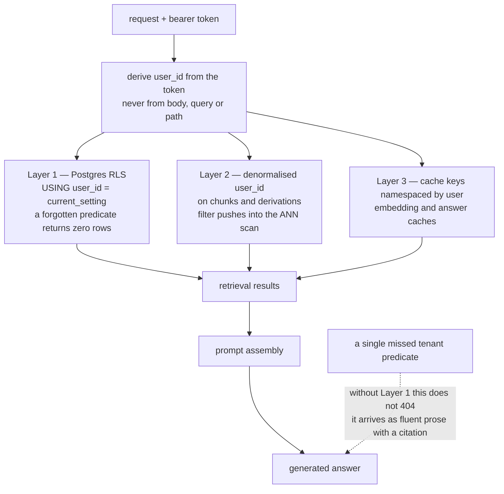
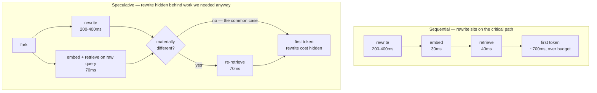
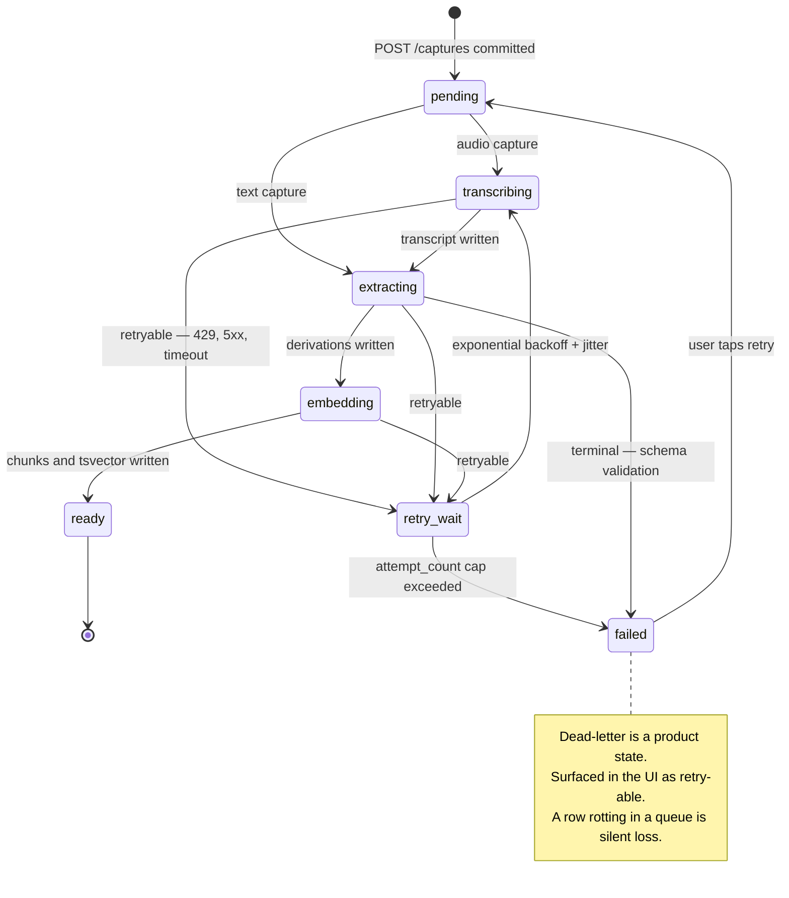

# memo — system design

**The living design document.** Built step by step against the
[Hello Interview delivery framework](00-framework.md). Each step gets appended as we work
through it; nothing here is final until the step below it exists, because later steps
routinely invalidate earlier ones.

This file holds **the design**. The critique — what was wrong in each first attempt and why
— lives in [session-01-memo.md](session-01-memo.md). Read that one for the learning; read
this one for the answer.

| Step | Status |
| --- | --- |
| 1. Requirements | ✅ done |
| 2. Core Entities | ✅ done |
| 3. API / System Interface | ✅ done |
| 4. Data Flow | ✅ done |
| 5. High Level Design | ✅ done |
| 6. Deep Dives | ✅ done |

Diagrams are inline mermaid — they render on GitHub and in most markdown viewers, and
they are source, so they diff.

> **Steps 3–6 were written by Claude as a worked senior-level answer, not produced by Akin.**
> Marked judgment calls (⚖️) are places where a different answer is defensible — those are
> the ones to argue with. See "How to review this" at the bottom.

---

## Step 1 — Requirements

### Scope

Multi-user product. Working bracket: **~100k registered, ~10k DAU**, with a note on what
changes at 10×. Capacity estimation deferred to the one place it decides something — the
vector index.

> Say this *first*, before designing. It converts a silent assumption into a visible,
> correctable decision. Not saying it is the most common Problem Navigation failure.

> **Open:** whether multi-user changes the *product* or only this exercise. The brief scopes
> V1 as single-user with auth out. Tracked as Q10 in [../open-questions.md](../open-questions.md).

### Functional requirements

1. **Users can capture text or audio in a single action, without categorising it.**
   No type picker, no folder, no tags at write time.
2. **Users can hold a multi-turn conversation over everything they've captured**, with
   every answer carrying citations back to the source captures.
   *(Amended from single-shot Q&A — see "What multi-turn cost us" below.)*
3. **The system automatically extracts structured derivations — todos, calendar events,
   ideas — from every capture and surfaces them for confirmation or correction.**

**Stated out of scope:** images, habit/health/faith types, morning digest, push
notifications, sharing, calendar sync. *Say the cuts out loud — naming them is scored;
omitting them silently reads as forgetting.*

Why the wording matters:

| Phrase | What it's load-bearing for |
| --- | --- |
| "single action, without categorising" | The product thesis. It's *why* extraction exists — if users tagged their own captures there'd be no LLM in the write path |
| "with citations" | Forces provenance to survive retrieval → prompt → generation. Constrains schema and chunk design |
| "derivations" | Avoids colliding the category name with a member name ("event" is also a derivation type) |
| "surfaces for confirmation or correction" | Makes extraction async *but visible* — which turns job-status modelling into a requirement, not an implementation detail |

### Non-functional requirements

**1. Durability — zero loss of accepted captures.**
Persisted and acknowledged before any processing is attempted. Transcription or extraction
failure leaves a visible, retryable state — never a dropped record.
> No upstream copy exists. A social feed can drop a write; a journal cannot.

**2. Tenant isolation — one user's content never enters another user's retrieval results or
generated answers.** Enforced at the data-access layer, not at individual call sites.
> A missed filter here doesn't render as somebody else's row. It gets paraphrased into
> prose with a citation and no visual tell. This failure mode is specific to RAG.

**3. Ask latency — first token < 1s p95, complete answer < 5s p95.**
> Split deliberately: retrieval and prompt assembly are a fixed cost we control; generation
> streams. Perceived latency is time-to-first-token, and one blended number hides which
> half regressed.

**4. Extraction quality — todo recall ≥ 0.90, precision ≥ 0.80** on a held-out labelled
set, enforced as a CI gate.
> In this architecture extraction correctness *is* application correctness — no schema
> constraint protects us. A quality bar with a number and an enforcement point is the
> strongest AI-specific signal available in this step.

**Held in reserve:** cost per active user, if the interviewer pushes on business
constraints. Drives model choice, caching, and whether self-hosted STT pays for itself.

### Cut, and what it cost

An earlier NFR — *capture acknowledged < 200ms p99, works offline*, an explicit
availability-over-consistency call on the write path — was **removed**. Offline capture
buys a local store, a sync engine, and conflict resolution, and would have consumed the
entire deep-dive budget on last-write-wins vs CRDTs. Cutting it also re-aligns the design
with the brief, which has no offline story.

**Two debts this creates:**
- Nothing in the requirements now justifies the **async worker pipeline**. At step 5 the
  question "why not transcribe in the request?" has no requirement to point at. Either
  re-add a slim capture-latency budget, or justify async on **durability** grounds — the
  stronger argument.
- There is no longer a **CAP call** anywhere in the requirements. Not mandatory in the
  top-5, but the guide's checklist leads with it and interviewers reach for it. Have an
  answer ready.

### What multi-turn cost us

Upgrading FR2 from single-shot to conversational bought three problems, all deferred to
Step 6:

- **Query rewriting is now mandatory.** *"What about the other one?"* carries no lexical or
  semantic signal — it must be resolved against history into a standalone query *before*
  retrieval runs. That's an extra LLM call on the critical path of the <1s TTFT budget.
- **Context management.** Turn 20 cannot send nineteen prior turns plus fresh chunks. A
  truncation or rolling-summary policy is required, and it fights citations: a summarised
  turn has lost its provenance.
- **Cost per turn grows superlinearly** if handled naively — history tokens plus retrieved
  chunks on every turn.

---

## Step 2 — Core Entities

First draft, deliberately incomplete. No fields yet — those get attached in Step 5, next to
the database, once we know what state each request mutates.

**Actors:** one type, `User`. No admin, no sharing, no organisation. Worth stating out loud
rather than leaving implied.

| Entity | What it is | Traces to |
| --- | --- | --- |
| **`User`** | The account. The tenant boundary | Multi-user scope; NFR2 isolation |
| **`Capture`** | The single write path. One timestamped thing the user put in, text or audio, uncategorised | FR1 |
| **`Recording`** | An audio asset attached to a capture. Lives in object storage, not a row | FR1 |
| **`Derivation`** | A typed extraction pointing back at its capture — todo, event, idea. Polymorphic on `kind` | FR3 |
| **`Chunk`** | An embedded unit of text. What retrieval returns and what a citation addresses | FR2 |
| **`Conversation`** | A thread of asking | FR2 |
| **`Message`** | One turn — a user question, or an assistant answer with its citations | FR2 |

### Why these names

Two rules did most of the work:

**1. Never name an entity after its category.** `Content`, `Data`, `Info`, `Item`, `Record`,
`Object` are the noun equivalent of a variable called `temp` — if the name would fit in any
system, it names nothing. The test: *could a user say this word out loud about their own
stuff?* "My captures" works. "My content" is what a CMS says.

**2. Reserve the terms of art.** In a RAG system `chunk`, `embedding`, `document`, `index`,
and `retrieval` already mean something specific to your interviewer. Spending one on
something else costs you the rest of the conversation, because every later use has to be
re-resolved.

| Rejected | Replaced by | Reason |
| --- | --- | --- |
| `Content` | `Capture` | Category noun. Also defined circularly — *"content (text and transcribed content)"* |
| `AudioChunks` | `Recording` | **`chunk` is a term of art for embedded text** — the worst available collision in this system. "Chunks" also implies segmentation, a V1.5 streaming concern; V1 uploads one file |
| `ExtractedData` | `Derivation` | "Data" carries no information. `Derivation` names the defining property: produced *from* something else, and points back at it |

### The structural fix

The first draft had `Content` and `AudioChunks` as **siblings** — two parallel things a
capture might be. That quietly reintroduces the modality split
[ADR 0008](../decisions/0008-one-primitive-many-views.md) exists to prevent.

Audio genuinely deserves its own entity: it lives in object storage rather than a row, it
has a different lifecycle (the file may be deleted after transcription to save money while
the transcript is kept forever), and V2 adds images beside it. But the relationship is
`Capture` ← `Recording` (parent, attachment), **not** `Capture` | `Recording` (alternatives).
One write path survives.

### Why `Chunk` is core and not an implementation detail

In most systems a chunk is a derived artifact of an indexing pipeline and has no place in a
conceptual model. Here it does, for one reason: **FR2 requires citations.** A citation must
point at something addressable, persisted, and stable — the specific passage the answer
drew from. Without `Chunk` as a first-class entity, citations have nothing to reference and
degrade into "the model mentions where it thinks this came from," which is exactly the
hallucination the requirement exists to prevent.

A requirement made a derived artifact into an entity. That link is the interesting part.

### Note on size

Seven entities is at the upper bound for this step. If an interviewer pushes back,
**`Recording` is the one to collapse** — in V1 it's 1:1 with `Capture` and could be three
columns on that row. Know which one you'd give up before you're asked.

### Emerging, not yet committed

NFR1 requires failed processing to leave a *visible, retryable state*, queryable days
later. Something must hold it. Whether that's a `Job` entity or a status column on
`Capture` is a real question — deferred to Step 5. Worth noticing that a **non-functional**
requirement just implied an entity.

---

## Step 3 — API / System Interface

REST + JSON over HTTPS. Bearer token auth. **The current user is derived from the token on
every request — never from a body field, a query param, or a path segment.** That isn't
style; it's the enforcement point for NFR2, and a `user_id` in a request body is a
horizontal-privilege-escalation bug waiting to be written.

### Capture

Audio needs a two-step upload. ⚖️

```http
POST /v1/recordings
  → 201 { "recording_id": "rec_...", "upload_url": "https://...", "expires_at": "..." }

PUT <upload_url>                          # client → object storage directly, bypasses the API

POST /v1/captures
  { "recording_id": "rec_..." }           # or { "text": "..." }
  → 202 { "id": "cap_...", "status": "pending", "created_at": "..." }
```

**Why presigned URLs and not multipart through the API:** streaming multi-megabyte audio
through app servers means they hold connections open for the duration of a mobile upload,
buffer bytes they have no use for, and scale on someone else's bandwidth. Push it to the
object store and the API handles only metadata.

**What it costs:** an extra round trip, and orphaned uploads — bytes that arrive but whose
`POST /captures` never lands. Handle with an object-storage lifecycle rule that expires
unclaimed keys after 24h. ⚖️ *At V1 scale, plain multipart through the API is defensible and
simpler; the presigned pattern is the answer once uploads are real traffic. Say which
you're choosing and why.*

`202 Accepted`, not `201` — the capture exists, the work does not. That status code is
carrying real meaning here.

```http
GET /v1/captures?cursor=&limit=50    → paginated, newest first
GET /v1/captures/{id}                → capture + processing status + its derivations
```

Cursor pagination, not offset — offset pagination over a table with constant inserts skips
and duplicates rows as the user scrolls.

### Derivations — review and correction

```http
GET   /v1/derivations?status=pending_review&kind=todo
PATCH /v1/derivations/{id}     { "payload": {...}, "status": "confirmed" | "rejected" }
POST  /v1/captures/{id}/derivations    { "kind": "todo", "payload": {...} }
```

`PATCH` handles "the extractor got this slightly wrong"; `POST` handles "the extractor
missed one entirely" — and those are *different* signals, precision versus recall.

**The senior observation:** every one of these writes is a hand-labelled training example
arriving for free, from a real user, on real data. This endpoint isn't just correction UX —
it's the intake pipe for the NFR4 eval set. Say that out loud; most candidates model the
correction endpoint and never notice they've built a labelling loop.

### Ask — conversational and streaming

```http
POST /v1/conversations                     → 201 { "conversation_id": "cnv_..." }

POST /v1/conversations/{id}/messages
  { "text": "what did I decide about the pricing thing?" }
  → 201 { "message_id": "msg_...", "stream_url": "/v1/messages/msg_.../stream" }

GET /v1/messages/{id}/stream               → text/event-stream
```

⚖️ **Why create-then-stream instead of one POST that returns SSE.** A single POST returning
a stream is fewer round trips and the more common answer. Two reasons to split it:

1. `EventSource` is GET-only, so POST+SSE forces manual stream parsing over `fetch` — and
   streaming `fetch` support in React Native has historically been patchy. This is a real
   client constraint, not a theoretical one.
2. **Resumability.** The message exists as a durable row before generation starts, so a
   client that drops off a train tunnel mid-answer reconnects to the same `stream_url`
   instead of losing the turn and re-paying for it.

The cost is an extra round trip and a message row that can exist in a permanently
unstreamed state if the client vanishes. Both acceptable. *A single POST+SSE endpoint is a
perfectly good answer — know why you'd pick either.*

**Event types on the stream:**

```
event: retrieval    data: { "citations": [ { "chunk_id", "capture_id", "snippet", "created_at" } ] }
event: token        data: { "delta": "..." }
event: done         data: { "message_id", "usage": { "input_tokens", "output_tokens", "cost_usd", "ms" } }
event: error        data: { "code", "message", "retryable": bool }
```

**`retrieval` is emitted before the first token, deliberately.** Citations are known the
moment retrieval finishes — they are a *retrieval* artifact, not a *generation* artifact.
Sending them first means the client paints its sources while the answer is still being
written, and it makes citation hallucination structurally impossible: the model is never
asked to produce a citation, only prose grounded in chunks the system already chose. This
one design detail is the difference between "we have citations" and "we have trustworthy
citations", and it's the highest-value thing in this entire API section.

```http
GET /v1/conversations                  → list, newest first
GET /v1/conversations/{id}/messages    → history with citations resolved
```

Note what is absent from every signature above: `user_id`.

---

## Step 4 — Data Flow

memo is a data-processing system, so this step earns its place. Two flows.

### Ingestion — capture to queryable

1. *(audio only)* Client requests a presigned URL; uploads bytes directly to object storage.
2. Client `POST /v1/captures`. Row is written with `status=pending`, **committed**, and
   `202` returned. **This is the durability boundary** — everything before it can fail and
   lose data; nothing after it can.
3. Enqueue `process_capture(capture_id)`.
4. Worker, if a recording is attached: fetch bytes → **transcribe** → write transcript onto
   the capture → `status=extracting`.
5. Worker: **extract derivations** via LLM structured output → validate against the Pydantic
   schema → write rows with `status=pending_review` and the `extractor_version` that
   produced them.
6. Worker: **chunk** the text → **embed** each chunk → write `chunks` rows carrying the
   embedding, the embedding model id, and a generated `tsvector`.
7. `status=ready`.


**Ingestion. Everything left of the durability boundary can fail and lose data; nothing right of it can.**



Every stage is independently retryable and idempotent. Stage boundaries are commit points,
so a crash at step 6 never re-runs steps 4–5 or re-bills for them.

### Retrieval — question to grounded answer

1. Receive question, load the conversation's recent history.
2. **Rewrite to a standalone query** against that history (skipped on the first turn — see
   the deep dive).
3. In parallel: embed the rewritten query → ANN search over `chunks`; and `tsquery`
   full-text search. **Both filtered to the calling user.**
4. Fuse the two ranked lists with **RRF** (`Σ 1/(60 + rank)`), take top-k.
5. **Emit `retrieval`** — citations are final at this point.
6. Assemble the prompt: system instructions + compacted history + retrieved chunks.
7. Stream generation → `token` events.
8. Persist the assistant message and its citation rows; log model, tokens, latency, cost →
   `done`.


**Ask. The `retrieval` event fires before the first token — citations are chosen by the system, never generated by the model.**



**Fusion detail. Two retrievers with opposite blind spots, combined on rank so their incomparable scores never need normalising.**



---

## Step 5 — High Level Design

### Components

| Component | Role | Why it's separate |
| --- | --- | --- |
| **Expo client** | Capture, review, ask | — |
| **API** (FastAPI, stateless, N behind an LB) | HTTP contract, auth, enqueue, stream | Stateless so it scales on request volume alone |
| **Object storage** (S3-compatible) | Recording bytes | Blobs never belong in Postgres |
| **Postgres + pgvector** | Single source of truth: rows, vectors, full-text | One store ⇒ consistency is a transaction, not a reconciliation job |
| **Redis** | Queue broker, embedding cache, rate limits | — |
| **Workers** (arq) | Transcribe, extract, embed | Separate deployable — scales on *queue depth*, and a burst of uploads must not degrade ask latency |
| **STT / LLM / embedding providers** | Inference | — |


**Component topology — note the two dashed paths: the client uploads bytes straight to object storage, and the API never touches them.**



The API and workers being separately scalable is the point, not an accident: their load
signals are uncorrelated and their failure modes shouldn't be shared.

### Schema — the fields that matter

Only the load-bearing columns. An interviewer assumes `users` has an email.

```
captures      id · user_id · kind(text|audio) · text · recording_id
              status(pending|transcribing|extracting|ready|failed)
              failure_reason · attempt_count · client_token · created_at

recordings    id · user_id · storage_key · duration_ms · bytes · mime

derivations   id · user_id · capture_id · kind · payload(jsonb)
              status(pending_review|confirmed|rejected|user_created)
              extractor_version · confidence · created_at

chunks        id · user_id · capture_id · derivation_id(null) · text
              embedding vector(N) · embedding_model · tsv(generated) · created_at

conversations id · user_id · title · created_at
messages      id · conversation_id · user_id · role · text · created_at
message_citations   message_id · chunk_id · rank
```


**Entities and the load-bearing columns. `user_id` appears on `chunks` and `derivations` even though it is reachable through `capture_id` — retrieval filters cannot afford a join.**



Three columns doing non-obvious work:

- **`client_token`** on captures — a client-generated idempotency key. A phone retrying a
  capture POST on a flaky connection must not create two captures. Unique on
  `(user_id, client_token)`.
- **`extractor_version`** on derivations — makes re-extraction over history possible *and
  measurable*. Without it you cannot tell whether a prompt change improved anything.
- **`embedding_model`** on chunks — changing embedding model means re-embedding the whole
  corpus. Recording which model produced each vector is free now and un-retrofittable later.

**`user_id` is denormalised onto `derivations` and `chunks`** even though it's reachable
through `capture_id`. Retrieval filters must not require a join — the tenant predicate has
to sit directly on the indexed table or it can't be pushed into the ANN scan.

### Indexes

- `chunks`: **HNSW** on `embedding`, **GIN** on `tsv`, btree on `(user_id, created_at)`
- `derivations`: `(user_id, kind, status)`, GIN on `payload`
- `captures`: `(user_id, created_at DESC)`, partial index `WHERE status = 'failed'`
- `messages`: `(conversation_id, created_at)`

### Answering the debt from Step 1: why async at all?

Cutting the capture-latency NFR removed the obvious justification. The stronger one was
always **durability (NFR1)**:

If transcription runs inside the request, the capture exists only as bytes in process memory
and a row that hasn't been written yet. A client disconnect, a deploy, an OOM, or a provider
timeout at second 40 of a 60-second transcription destroys something that existed nowhere
else. Committing the row *first* and processing *after* is the only structure where "zero
loss of accepted captures" is even expressible — and it's what lets a failure become a
visible retryable state instead of a silence.

Latency was the convenient argument. Durability is the correct one.

---

## Step 6 — Deep Dives

Led proactively, ordered by the non-functional requirements they defend.

### 1. Tenant isolation — defence in depth (NFR2)

A repository layer that takes `user_id` is discipline, and discipline fails silently at 2am.
Three layers instead:

1. **Postgres row-level security.** `USING (user_id = current_setting('app.user_id'))`, set
   per transaction. Isolation becomes a database guarantee rather than a code convention —
   a forgotten predicate returns zero rows instead of someone else's journal.
   ⚖️ *Cost, and it's real:* RLS interacts awkwardly with connection pooling (the setting
   must be applied per transaction, not per connection), it complicates query plans, and it
   makes debugging "why is this empty" harder. A repository layer plus a test that fails any
   query lacking a tenant predicate is a legitimate cheaper answer.
2. **Denormalised `user_id`** on every retrievable table, so the filter is always available
   without a join.
3. **Cache keys namespaced by user.** This is the one people miss: even with flawless
   retrieval, a semantic answer cache or an embedding cache keyed on query text alone
   leaks across tenants — and it leaks as *fluent prose with a citation*, which no test
   asserting on row IDs will ever catch.


**Defence in depth. The dashed edge is the failure mode that makes this different from ordinary multi-tenancy.**



### 2. Filtered ANN at scale, and the capacity math I promised (NFR3)

Here's where the numbers actually decide something, which is why they were deferred to here.

10k DAU × ~10 captures/day ≈ **100k captures/day**. At ~2 chunks per capture that's **~200k
chunks/day ≈ 70M chunks/year**, growing monotonically because nothing is ever deleted.

That is exactly the range where pgvector stops being obviously free. And every single query
carries `WHERE user_id = ?`, which is the hard case for HNSW: Postgres either pre-filters
(losing the index) or searches the graph and drops non-matching results (returning fewer
than *k*, sometimes far fewer, because a single user's chunks are a vanishing fraction of
the graph). pgvector's iterative index scans mitigate this but don't erase it.

Options, in the order I'd try them:

1. **Partition `chunks` by `user_id` hash**, with a per-partition HNSW index. The tenant
   filter becomes partition pruning, so each search runs against a graph containing only
   plausible candidates. Cost: partition management, and cross-partition planning overhead.
2. **Per-tenant indexes.** Clean at hundreds of tenants, absurd at 100k.
3. **Move vectors to a dedicated store** with native tenant namespacing — and accept the
   dual-write problem [ADR 0002](../decisions/0002-pgvector-not-a-vector-database.md) was
   written to avoid.

**I'd pick (1)** and revisit [ADR 0002](../decisions/0002-pgvector-not-a-vector-database.md)
when p95 retrieval — measured with generation excluded — crosses 200ms. Note that ADR was
written for a single user; multi-tenancy is precisely the premise change that should reopen
it, and saying so is better than defending it.

### 3. Query rewriting inside the TTFT budget (NFR3)

Multi-turn put a second LLM call in front of retrieval, and the budget is <1s to first token:

```
rewrite ~200-400ms → embed ~30ms → hybrid retrieve ~40ms → RRF ~1ms → first token
```

That leaves very little slack. Four mitigations, cheapest first:

- **Skip on turn 1.** There's no history to resolve against. Free.
- **Skip when the query is self-contained.** A cheap classifier — or a heuristic on
  pronouns and deictic phrases — routes most questions straight past the rewrite.
- **Use a small fast model.** Rewriting is an easy task; it does not need your answer model.
- **Speculative parallel retrieval.** Fire retrieval on the *raw* query at the same time as
  the rewrite. If the rewrite comes back materially different, re-retrieve; if not — the
  common case — you've hidden the entire rewrite latency behind work you needed anyway.


**Hiding the rewrite. Speculative retrieval on the raw query costs one wasted embed in the uncommon case and saves 200-400ms in the common one.**



### 4. The async pipeline: idempotency, retries, dead-letter (NFR1)

Delivery is **at-least-once**. Exactly-once is a marketing claim; the real answer is
at-least-once delivery plus idempotent effects.

- **Idempotency key:** unique on `(capture_id, stage, extractor_version)`. A duplicate run
  loses the race to a constraint violation and no-ops. Enforced by the database, because
  check-then-insert in application code is a race, not a guard.
- **Retries:** exponential backoff **with jitter** — without jitter, a provider blip
  synchronises every worker into a thundering herd on recovery.
- **Classify failures.** 429s, 5xxs, and timeouts retry. Schema-validation failures after N
  repair attempts are terminal — retrying a deterministic parse failure just burns money.
- **Dead-letter is a product state, not an ops state.** `status=failed` with a
  `failure_reason`, surfaced in the UI as *"couldn't process this — retry?"*, with a
  user-triggered retry. NFR1 says never silently lost; a row rotting in a queue nobody
  watches is silently lost.
- **`attempt_count` cap** so one poison capture can't consume a worker forever.


**Capture lifecycle. `failed` is reachable from three places and exits only through a user-visible retry.**



### 5. Extraction quality as a merge gate (NFR4)

- ~40 hand-labelled captures as a golden set, committed to the repo.
- Per-kind precision and recall, because the two errors are not equally bad: a **missed**
  todo (recall) erodes trust quietly and permanently; an **invented** one (precision) is
  visible and one tap to dismiss. Weight recall higher, and say so.
- CI fails the PR when either metric drops below threshold. Prompts are code.
- The correction endpoint from Step 3 feeds new labelled examples continuously.
- `extractor_version` on every row makes "re-run the new extractor over last month and
  diff" a query rather than a project.

### 6. Context, cost, and streaming failure

- **Context:** last N turns verbatim + a rolling summary of everything older. Citations are
  preserved only for verbatim turns — a summarised turn has lost its provenance, and
  pretending otherwise produces confidently mis-attributed answers.
- **Cost:** log model, tokens, latency, and cost on every LLM call, attributed to a user.
  Cost-per-active-user is a first-class metric, not a monthly surprise.
- **Client disconnect mid-stream:** you are still paying for tokens nobody will read.
  Detect the dropped connection and cancel the upstream request. Persist whatever generated
  so the resumable `stream_url` has something to replay.

### What I'd cut if the interview ran short

Deep dives 1 and 2 are non-negotiable — they defend the two requirements most specific to
this system. 5 is the strongest AI-engineering signal. 3, 4, and 6 are the ones to
compress.

### What changes at 10×

100k DAU: chunk growth reaches ~700M/year and partition-per-tenant-hash stops being
sufficient — that's the real trigger for a dedicated vector store. Workers need per-tenant
fairness so one user's bulk import can't starve everyone else's queue. Postgres needs read
replicas for the retrieval path, and the write path needs its own primary.

---

## How to review this

Three places I'd expect a good reviewer to push back, because each is a genuine call rather
than a fact:

1. **Create-then-stream** for ask. It's two round trips to buy resumability and dodge a
   React Native constraint. A single POST returning SSE is simpler and very defensible —
   is the resumability worth it?
2. **RLS for tenant isolation.** It's the strongest guarantee and the highest ongoing tax,
   especially against connection pooling. Is a repository layer plus a lint-style test the
   better engineering trade?
3. **Partitioning `chunks` rather than moving to a vector database.** This keeps
   [ADR 0002](../decisions/0002-pgvector-not-a-vector-database.md) alive under a premise it
   wasn't written for. At 70M chunks/year, is that loyalty or judgment?

And one thing to check rather than argue: every capacity number here is an order-of-magnitude
estimate from assumed usage, not a measurement. If an interviewer leans on them, the honest
move is to say what they're derived from and what would change the conclusion.
